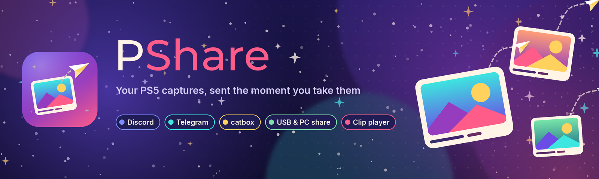
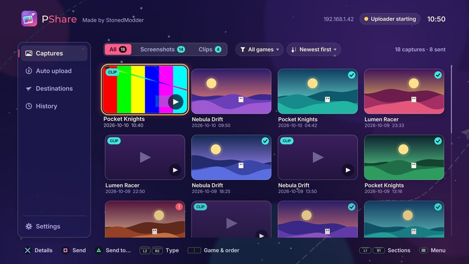
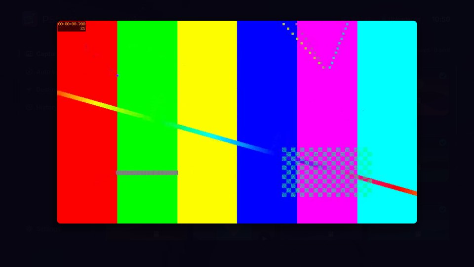
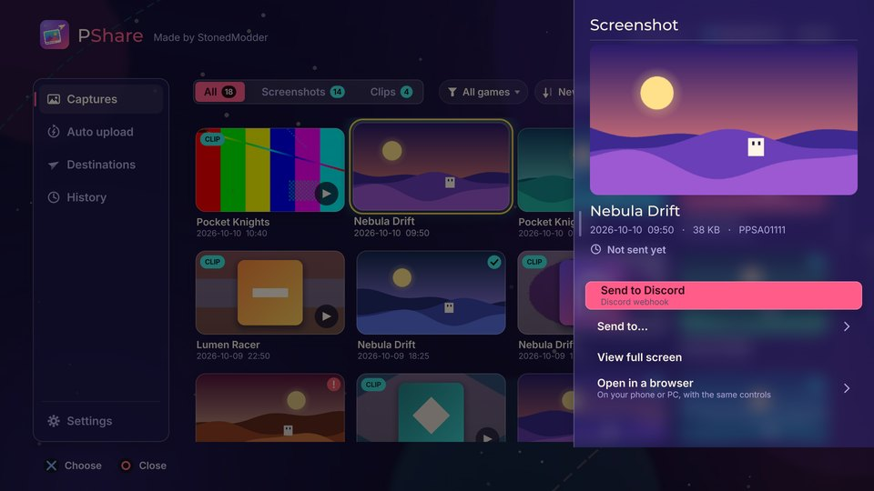
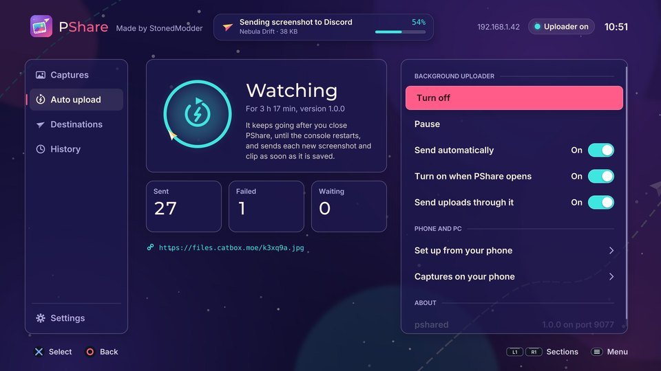
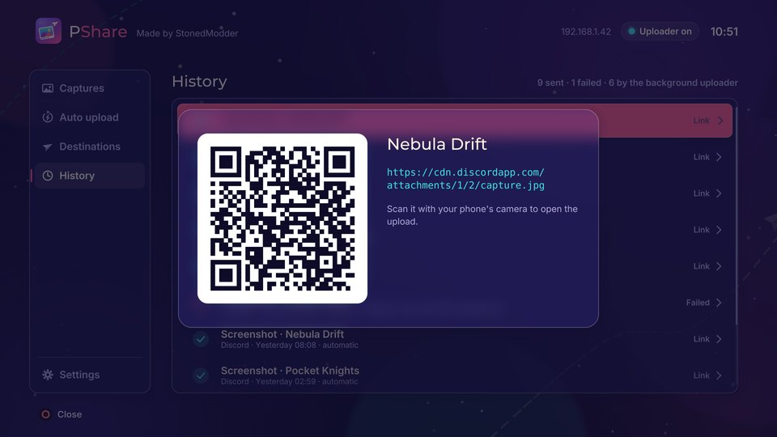
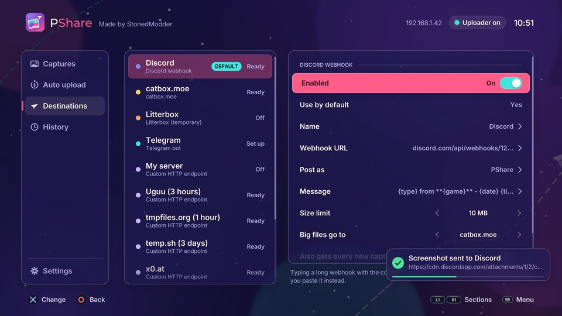

<p align="center">
  
</p>

<p align="center">
  <a href="../../releases/latest"></a>
  
  
  <a href="LICENSE"></a>
</p>

<p align="center"><b>Made by StonedModder</b></p>

**PShare sends your PS5 captures where you want them, the moment you take
them.** Take a screenshot or save a clip with the Create button and PShare
sends it to Discord, Telegram, catbox.moe, a USB drive, a shared folder
on your PC or a dozen other places, automatically and in the background, even
after you close the app. It doubles as a media gallery: browse every capture
by game, watch clips with sound, and open anything on your phone from a QR
code.

> PShare is homebrew for jailbroken consoles. It needs an ELF loader on port
> 9021 (the usual ps5-payload-dev `elfldr`).

<p align="center">
  
  
  
  
  
  
</p>

<sub>Screens rendered by the PC preview (`make preview`) with invented games.</sub>

## Features

- **Automatic uploads.** A small background uploader, `pshared`, notices each
  new screenshot and clip, waits until a clip has finished writing, and sends
  it. It keeps running after PShare closes.
- **Many destinations.** Discord webhooks, Telegram bots, catbox.moe,
  Litterbox, any multipart HTTP endpoint, a USB drive or console folder, and PC shares over SMB 2/3. Account-free hosts
  (Uguu, tmpfiles.org, temp.sh, x0.at, Gofile) are set up out of the box.
- **Smart routing.** Per-game destinations, size limits with fallbacks (a
  40 MB clip goes to catbox and Discord gets the link), and destinations that
  receive every capture as well, such as a copy on a USB stick.
- **Media gallery.** Every capture with thumbnails, clips included, filtered
  by kind or by game (picked from the games you actually have captures of,
  named even when the game is a PS4 title or no longer installed),
  newest or oldest first. A check marks what has already been sent.
- **Clip player.** Full screen with sound, using FFmpeg (VP9, H.264, HEVC,
  AV1 with Opus or AAC), including the PS5's own recordings. Its buttons
  match [VLC for PS5](https://github.com/ZiZc3/VLC).
- **Phone and PC.** While PShare is open, any capture can be opened in a
  browser on the same network with the same controls, and the whole gallery
  can be browsed, streamed and downloaded. The setup page lets you paste
  webhooks and tokens from your phone instead of typing them with a
  controller.
- **History with QR codes.** Every upload, from the app or the background,
  with its link as a QR code to open on your phone. Failed ones can be
  retried.
- **Built-in elevation.** The app carries its own
  [Lapy](https://github.com/blackbearreloaded/PS5-Lapy-JB-Daemon) helper, the
  same build ProsperoStore uses, so there is nothing else to install.

## Installation

1. Download `PPSA99773.zip` from the [latest release](../../releases/latest)
   and check it against `SHA256SUMS` if you like.
2. Extract the `PPSA99773` folder to where your loader installs homebrew from
   (for example `/data/homebrew/` with ShadowMountPlus), and start
   **PShare** from the Media area of the home screen.
3. Make sure your jailbreak has the ELF loader listening on port 9021. PShare
   uses it to send its Lapy helper and to start `pshared`.
4. Open **Destinations**, fill in at least one (or use **Auto upload › Set up
   from your phone**), then take a screenshot.

`pshared.elf` is also published on its own and can be sent with any payload
sender. It reads the same `/data/pshare/config.ini`.

## Controls

The full list is also in the app under **Settings › Controls**.

**Captures**

| Button | Action |
| --- | --- |
| ✕ | Details: play, send, open in a browser, view full screen |
| □ / △ | Send / Send to… |
| L2 / R2 | All · screenshots · clips |
| Touchpad | Choose a game and the order (also the two buttons right of the tabs) |
| L1 / R1 | Switch sections |
| Options | Menu |

**Clip player** (the same buttons as VLC for PS5 wherever the two apps overlap)

| Button | Action |
| --- | --- |
| ✕ | Play / pause |
| ← / → | Back / forward 10 s |
| L2 / R2 | Back / forward 30 s |
| L1 / R1 | Previous / next clip |
| □ | Send to the default destination |
| △ | Send to… |
| ○ | Close |

**Browser page** (a capture › Open in a browser): a controller connected to
the PC uses the console's buttons. On a keyboard: Space play/pause, ← / →
10 s, `[` / `]` 30 s, `S` send, `T` send to…, `,` / `.` newer / older, Esc
back. On a phone, the buttons under the picture.

## Configuration

Everything is editable in the app or from your phone. The file behind it is
`/data/pshare/config.ini`:

```ini
[general]
auto_upload = true
default_destination = discord
also_send = usb

[destination.discord]
type = discord
url = https://discord.com/api/webhooks/<id>/<token>
message = {type} from **{game}** - {date} {time}
max_mb = 10
fallback = catbox

[title_destinations]
PPSA01234 = telegram
```

Every key is described in [docs/CONFIGURATION.md](docs/CONFIGURATION.md).

## Ports

| Port | Who | What |
| --- | --- | --- |
| 9021 | your jailbreak | the ELF loader PShare sends `lapy.elf` and `pshared.elf` to |
| 9077 | pshared, localhost only | the control line the app uses |
| 9078 | pshared, local network | the browser page and gallery, open only while PShare runs or setup is on |

## Building

Linux or WSL with clang/lld 18+, ninja, make and python3:

```bash
make deps     # payload SDK, PacBrew (libcurl, FFmpeg, libsmb2), ps5-opengl
make          # dist/PPSA99773/, dist/PPSA99773.zip, dist/pshared.elf
make test     # unit tests (ASan/UBSan), Lapy client tests, tooling tests
make preview  # every page rendered on the PC into build/preview/
```

See [docs/BUILDING.md](docs/BUILDING.md) for the full requirements and
targets, and [docs/ARCHITECTURE.md](docs/ARCHITECTURE.md) for how the app and
the uploader work together.

## FAQ

**Why is it in the Media area instead of with my games?**
PShare is a media app. To build it as a game instead, run
`make init TITLE_ID=PPSA99773 APP_NAME="PShare" CONTENT_SUFFIX=PSHARE0000000001 APP_CATEGORY=game`
before `make`.

**The app says "No file access in the app".**
Elevation failed: check that the ELF loader is running on port 9021, then
restart PShare. The log line `[PShare] elevation …` says which step stopped.

**Uploads stop when I close the app.**
They should not: check **Auto upload** shows the uploader as running, and
that **Send uploads through it** is on.

**Discord does not accept my clip.**
Without server boosts Discord takes files up to 10 MB. Keep `max_mb = 10` and
a `fallback` so bigger clips go to a file host and Discord gets the link.

## Contributing

Bug reports and pull requests are welcome. Please read
[CONTRIBUTING.md](CONTRIBUTING.md) first, and remove webhook URLs and tokens
from any log you attach.

## Credits

- [VLC for PS5](https://github.com/ZiZc3/VLC) by **ZiZc3**: its finding that
  the PS5's recordings carry an Opus header FFmpeg refuses is why clips play
  with sound here (`fix_ps5_opus_header` in `src/app/video.cpp`), and its
  player buttons are the ones PShare follows.
- [ps5-native-app-boilerplate](https://github.com/blackbearreloaded/ps5-native-app-boilerplate),
  [ps5-homebrew-ui](https://github.com/blackbearreloaded/ps5-homebrew-ui),
  [ProsperoStore](https://github.com/blackbearreloaded/ProsperoStore) and
  [PS5-Lapy-JB-Daemon](https://github.com/blackbearreloaded/PS5-Lapy-JB-Daemon)
  by BlackBearReloaded: the build pipeline, the UI kit, the elevation client
  and the elevation helper.
- [Porkfolio](https://github.com/StonedModder/Porkfolio), for where the PS5
  keeps its captures.
- [ps5-payload-dev](https://github.com/ps5-payload-dev) for the payload SDK
  and PacBrew, and FFmpeg, libcurl and libsmb2.

Full details and licences are in [THIRD_PARTY_NOTICES.md](THIRD_PARTY_NOTICES.md).

## License

PShare is licensed under the [GNU General Public License v3.0 or later](LICENSE).
Third-party components keep their own licences.

PlayStation and PS5 are trademarks of Sony Interactive Entertainment. Discord,
Telegram and the other services named here belong to their owners. PShare is
not affiliated with or endorsed by any of them.
